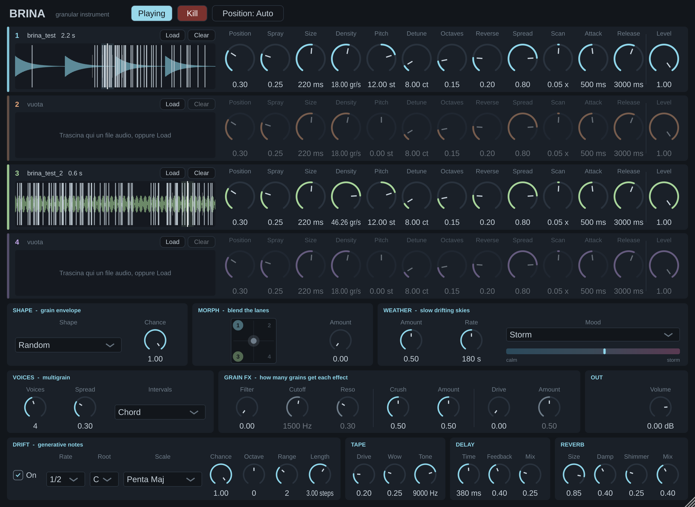

# Brina

Ambient granular instrument for Ableton Live (VST3 / AU, macOS). It turns a sample into textures
that evolve on their own. Inspired by the features of GrainBrick, written from scratch.

Two plugins share the same engine:

| Plugin | Where it goes | Audio source |
|---|---|---|
| **Brina** | MIDI track (instrument) | audio file |
| **Brina FX** | audio track (effect) | audio file, or **Rec** of the track input (max 60 s) |

There are four audio sources, the **lanes**, all visible at once: each lane has its own sample
and its own grain controls, like four granulators in the same plugin.

## Installation

**Without compiling (GitHub):** push this folder to a GitHub repository. The *Actions* tab builds
it and produces `Brina-macOS.zip`. Copy the contents of `VST3` into
`~/Library/Audio/Plug-Ins/VST3/` and of `Components` into `~/Library/Audio/Plug-Ins/Components/`,
then unblock the downloaded files from Terminal:

    xattr -dr com.apple.quarantine ~/Library/Audio/Plug-Ins/VST3/Brina*.vst3 ~/Library/Audio/Plug-Ins/Components/Brina*.component

**Compiling on the Mac:** you need Xcode and CMake (`brew install cmake`). Double-click
`build_mac.command`: it builds the plugins and installs them in the right folders.

In Live: Settings > Plug-Ins > enable VST3 (and/or Audio Units) > *Rescan*.

**Updating to a new version:** quit Live before replacing the plugins. If Live scans while the
files are being copied, it marks the plugin as unloadable and never tries again: the files in the
zip always have the same date, so to Live they have not changed. If Brina does not show up after
an update, quit Live, refresh the files' date (use the folder you installed them in; for
`/Library/...` prepend `sudo`) and reopen Live with *Rescan*:

    find ~/Library/Audio/Plug-Ins/VST3/Brina*.vst3 ~/Library/Audio/Plug-Ins/Components/Brina*.component -exec touch {} +

## How to use

1. Drag an audio file onto a lane's waveform (or use its **Load**). In Brina FX you can press
   **Rec** to capture the audio passing through the track into that lane; grains already play
   while you record. Dragging several files at once fills the lanes one after another.
   **Clear** empties the lane.
2. With **Drift** on, the plugin plays by itself. Turn it off to play it over MIDI
   (C3 = original pitch). To send MIDI to Brina FX: create a MIDI track and set its *MIDI To*
   to the audio track.
3. Click a lane's waveform to choose where its grains are born.
4. At the top: **Playing / Stopped** starts and stops the plugin (when stopped no notes or grains
   are born and the tails fade out on their own); **Kill** silences everything at once, clearing
   notes, grains and the delay and reverb tails. In Brina FX the *Dry In* signal keeps passing
   in both cases.
5. **Position: Auto / Fixed** (at the top, for all lanes): in *Auto* the position moves on its
   own at each lane's *Scan* speed (as always); in *Fixed* it stays where you put it.

The three controls are parameters (*Play*, *Kill*, *Position Mode*), so they can be automated or
mapped to a controller in Live. *Kill* fires on every value change.

**Lanes** - each with its own controls: *Position* read point · *Spray* scatter around the point ·
*Size* grain length · *Density* grains per second · *Pitch* transposition · *Detune* random
detuning · *Octaves* probability of grains at ±1 octave · *Reverse* probability of reversed
grains · *Spread* stereo width · *Scan* speed at which the position moves on its own ·
*Attack / Release* note envelope · *Level* lane volume. An empty lane does not play and its
controls are dimmed, but it can be set up before loading the file.

The sections below the lanes apply to all of them.

**Voices** (multigrain) - *Voices* how many grains are born together for each note, from 1 to 8:
the voices fan out around *Position* and across the stereo field, while the level stays the
same · *Spread* distance between the voices' read points · *Intervals* tuning of the voices:
*Unison* (slightly detuned from each other), *Octaves*, *Fifths*, *Chord* (stacked thirds on the
Drift scale).

**Grain FX** - effects applied to individual grains, not to the whole sound. For each one, the
first control sets how many grains get it (0 = none, 1 = all; at half, about one grain in two,
chosen at random), and a grain can get more than one. *Filter* low-pass, with *Cutoff* (each
grain gets a slightly different cutoff) and *Reso* · *Crush* bit and sample-rate reduction, with
*Amount* · *Drive* saturation, with *Amount*.

**Shape** - the shape (envelope) of the grains, in every lane. *Shape* picks it: *Swell* rises
slowly and falls fast, *Twin* has two humps, *Tremolo* pulses, *Pluck* starts sharp and fades,
*Random* picks one for each grain · *Chance* how many grains get it (0 = all keep the usual soft
window, 1 = all get the chosen shape). Every shape has the same loudness as the usual window.

**Morph** - an XY pad with lanes *1-4* on the corners (1 and 2 at the top, 3 and 4 at the
bottom): the point crossfades the lanes' levels, so the closer it is to a corner, the louder that
lane. The blend keeps the overall loudness steady and only counts lanes that hold a sample; on the
corner of an empty lane nothing changes. *Amount* how much the pad counts (0 = lanes play as set,
1 = fully the pad's mix). Each corner glows with its lane's current level. Double-click the pad to
go back to the middle. The point is two parameters (*Morph X*, *Morph Y*), so it can be automated.

**Weather** - a slow weather that moves *Density*, *Spray* and *Size* of every lane and the tape
*Tone* on its own, with slow changes and quicker gusts. The knobs stay where they are: the weather
works on top of them, so it does not fight Live's automation. *Amount* how much it moves (0 = off)
· *Rate* length of one slow cycle, 30 s to 20 minutes · *Mood*: *Calm* thins out and darkens,
*Breeze* moves gently, *Storm* thickens and brightens with gusts, *Changing* drifts from calm to
storm by itself. The strip under *Mood* shows the sky right now.

**Drift** - note generator: a random walk on the chosen scale. *Rate* step (synced to Live's
tempo) · *Chance* probability of a note at each step · *Root / Scale* key · *Octave / Range*
register and span · *Length* note length in steps.

**Tape** saturation, wow & flutter, filter · **Delay** cross-fed stereo, the time "slides" like
tape · **Reverb** with *Shimmer* (octave up in the feedback) · **Out** *Dry In* (FX only: the
original signal) and *Volume*.

The samples of the four lanes are saved with the Live project: files as a path, recordings inside
the set (FLAC).

Sets saved with earlier versions open and sound as before: their sample is in lane 1, with a
single voice and no per-grain effects; Shape, Morph and Weather start off, and until they are
turned up the sound is identical to before. The window can be resized by dragging its bottom-right
corner.

## Development

    cmake -S . -B build -DBRINA_INSTALL=OFF -DBRINA_TESTS=ON && cmake --build build
    ./build/BrinaTest_artefacts/Release/BrinaTest
    ./build/BrinaPluginTest_artefacts/Release/BrinaPluginTest /tmp
    ./build/BrinaFXPluginTest_artefacts/Release/BrinaFXPluginTest /tmp

`Source/Engine.h` holds all the DSP and does not depend on the host. Built with
[JUCE](https://juce.com) 8 (AGPLv3 / commercial license: fine for personal use; distributing the
plugin closed-source requires a JUCE license). Parameter list: `docs/parametri.md`.
