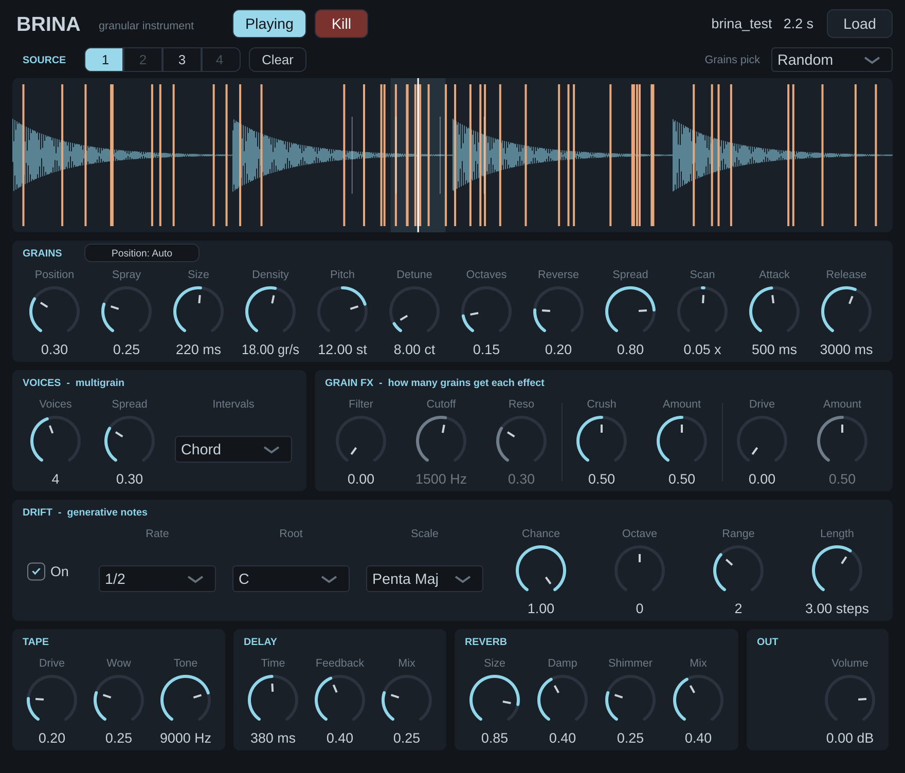

# Brina

Strumento granulare ambient per Ableton Live (VST3 / AU, macOS). Trasforma un campione in
texture che evolvono da sole. Ispirato alle funzioni di GrainBrick, scritto da zero.

Sono due plugin con lo stesso motore:

| Plugin | Dove va | Sorgente audio |
|---|---|---|
| **Brina** | traccia MIDI (strumento) | file audio |
| **Brina FX** | traccia audio (effetto) | file audio oppure **Rec** dell'ingresso della traccia (max 60 s) |

Le sorgenti audio sono quattro (**slot 1-4**): ogni grano legge da uno degli slot pieni, quindi
si possono mescolare fino a quattro suoni diversi nella stessa nuvola.

## Installazione

**Senza compilare (GitHub):** carica questa cartella in un repository GitHub. La scheda *Actions*
compila da sola e produce `Brina-macOS.zip`. Copia il contenuto di `VST3` in
`~/Library/Audio/Plug-Ins/VST3/` e di `Components` in `~/Library/Audio/Plug-Ins/Components/`,
poi sblocca i file scaricati dal Terminale:

    xattr -dr com.apple.quarantine ~/Library/Audio/Plug-Ins/VST3/Brina*.vst3 ~/Library/Audio/Plug-Ins/Components/Brina*.component

**Compilando sul Mac:** servono Xcode e CMake (`brew install cmake`). Doppio clic su
`build_mac.command`: compila e installa i plugin nelle cartelle giuste.

In Live: Impostazioni > Plug-Ins > attiva VST3 (e/o Audio Units) > *Rescan*.

**Aggiornare a una versione nuova:** chiudi Live prima di sostituire i plugin. Se Live fa uno
scan mentre i file vengono copiati, segna il plugin come non caricabile e non lo riprova più:
i file dello zip hanno sempre la stessa data, quindi per Live non cambiano. Se Brina non compare
dopo un aggiornamento, chiudi Live, aggiorna la data dei file (usa la cartella dove li hai
installati; per `/Library/...` aggiungi `sudo` davanti) e riapri Live con *Rescan*:

    find ~/Library/Audio/Plug-Ins/VST3/Brina*.vst3 ~/Library/Audio/Plug-Ins/Components/Brina*.component -exec touch {} +

## Come si usa

1. Trascina un file audio sulla forma d'onda (o **Load**). In Brina FX puoi premere **Rec**
   per catturare l'audio che passa nella traccia; mentre registri i grani suonano gia'.
   Il file va nello slot selezionato nella riga **Source** (1-4); trascinando piu' file insieme
   si riempiono gli slot uno dopo l'altro. **Clear** svuota lo slot selezionato.
2. Con **Drift** acceso il plugin suona da solo. Spegnilo per suonare tu via MIDI
   (Do3 = intonazione originale). Per mandare MIDI a Brina FX: crea una traccia MIDI e
   imposta *MIDI To* sulla traccia audio.
3. Clicca sulla forma d'onda per scegliere da dove nascono i grani.
4. In alto: **Playing / Stopped** avvia e ferma il plugin (da fermo non nascono note ne' grani
   e le code sfumano da sole); **Kill** fa silenzio subito, azzerando note, grani e code di
   delay e riverbero. In Brina FX il segnale *Dry In* continua a passare in entrambi i casi.
5. **Position: Auto / Fixed** (nella sezione Grains): in *Auto* la posizione scorre da sola alla
   velocita' di *Scan* (come sempre); in *Fixed* resta ferma dove la metti.

I tre comandi sono parametri (*Play*, *Kill*, *Position Mode*), quindi si possono automatizzare
o mappare a un controller in Live. *Kill* scatta a ogni cambio di valore.

**Grains** - *Position* punto di lettura · *Spray* dispersione attorno al punto · *Size* durata
del grano · *Density* grani al secondo · *Pitch* trasposizione · *Detune* stonatura casuale ·
*Octaves* probabilita' di grani a ±1 ottava · *Reverse* probabilita' di grani al contrario ·
*Spread* apertura stereo · *Scan* velocita' con cui la posizione scorre da sola ·
*Attack / Release* inviluppo delle note.

**Source** - gli slot *1-4* scelgono quale sorgente vedi e carichi (quelli pieni hanno il numero
piu' chiaro). *Grains pick* decide da quale slot legge ogni grano: *Random* a caso, *Cycle* a
rotazione, *Per Voice* una sorgente fissa per ogni voce. *Position*, *Spray* e *Scan* valgono per
tutti gli slot, in proporzione alla loro durata.

**Voices** (multigrain) - *Voices* quanti grani nascono insieme per ogni nota, da 1 a 8: le voci
si aprono a ventaglio attorno a *Position* e nello stereo, il volume resta lo stesso · *Spread*
distanza tra i punti di lettura delle voci · *Intervals* intonazione delle voci: *Unison* (appena
stonate fra loro), *Octaves*, *Fifths*, *Chord* (terze sovrapposte sulla scala di Drift).

**Grain FX** - effetti applicati ai singoli grani, non al suono intero. Per ognuno il primo
controllo dice quanti grani lo ricevono (0 = nessuno, 1 = tutti; a meta' circa un grano su due,
scelto a caso), e un grano puo' riceverne piu' d'uno. *Filter* passa-basso, con *Cutoff* (ogni
grano ha un taglio un po' diverso) e *Reso* · *Crush* riduzione di bit e di frequenza, con
*Amount* · *Drive* saturazione, con *Amount*.

**Drift** - generatore di note: passeggiata casuale sulla scala scelta. *Rate* passo (legato al
tempo di Live) · *Chance* probabilita' di una nota a ogni passo · *Root / Scale* tonalita' ·
*Octave / Range* registro ed estensione · *Length* durata delle note in passi.

**Tape** saturazione, wow & flutter, filtro · **Delay** stereo incrociato, il tempo "scivola"
come un nastro · **Reverb** con *Shimmer* (ottava sopra nel feedback) · **Out** *Dry In*
(solo FX: segnale originale) e *Volume*.

I campioni dei quattro slot vengono salvati col progetto di Live: i file come percorso, le
registrazioni dentro il set (FLAC).

I set salvati con le versioni precedenti si aprono e suonano come prima: il loro campione e'
nello slot 1, con una voce sola e nessun effetto per grano.

## Sviluppo

    cmake -S . -B build -DBRINA_INSTALL=OFF -DBRINA_TESTS=ON && cmake --build build
    ./build/BrinaTest_artefacts/Release/BrinaTest
    ./build/BrinaPluginTest_artefacts/Release/BrinaPluginTest /tmp
    ./build/BrinaFXPluginTest_artefacts/Release/BrinaFXPluginTest /tmp

`Source/Engine.h` contiene tutto il DSP e non dipende dall'host. Costruito con
[JUCE](https://juce.com) 8 (licenza AGPLv3 / commerciale: va bene per uso personale; per
distribuire il plugin a codice chiuso serve una licenza JUCE).
